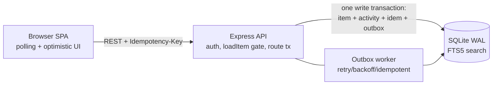

# Ops Desk – Newtonite Software Engineering Challenge

Internal tool to create, claim, route and resolve operational work items across teams, with server-enforced workflow, team roles, audit history and safe concurrent usage.

**Stack:** Node.js 20+ · Express · SQLite (better-sqlite3) · plain HTML/JS frontend (no build step).

## Run
```bash
npm install
npm start            # http://localhost:4000 (creates ops.db and seeds 3000 items; see .env.example)
npm test             # 15 tests: API correctness + UI smoke
```
No Docker or external services needed. Log out and sign in as another user to see role differences.

| User (email) | Teams / role |
|---|---|
| alice@demo.test | Platform – LEAD |
| bob@demo.test | Platform – MEMBER |
| carol@demo.test | Payments – LEAD |
| dave@demo.test | Platform – VIEWER |
| eve@demo.test | Platform MEMBER + Payments MEMBER |

Password for every demo user: `demo123`. Sign in via the UI, or `POST /api/login {email,password}` -> bearer token (`Authorization: Bearer <token>`). Passwords are scrypt-hashed; sessions are random tokens stored server-side.

## Roles
VIEWER: read. MEMBER: create, claim, comment, edit, move through workflow. LEAD: also approve/reject (AWAITING_APPROVAL -> RESOLVED), close, assign, change priority.

## Workflow
`OPEN -> IN_PROGRESS -> AWAITING_APPROVAL -> RESOLVED -> CLOSED` (plus back-transitions, see `TRANSITIONS` in `src/app.js`).

## Architecture


## Critical behaviours (each has a test in `test/critical.test.js`)
concurrent claim · stale-version update · idempotency (incl. 20 parallel retries and key reuse with a different body) · workflow rules + Lead-only approval · resource-level authorization (404/403) · outbox retry, FAILED cap and idempotent handler · login/session checks · team-scoped full-text search · assignment rules. The UI also does optimistic claim with rollback on server rejection.

## Known limitations
- SQLite = one writer at a time (WAL + busy_timeout, fine for this exercise). Production: PostgreSQL; the conditional `UPDATE ... WHERE version=?` / `assignee_id IS NULL` pattern and the transaction structure port 1:1.
- Worker runs inside the API process; use a separate process/queue at scale. Notifications are stored in a table, no email/push.
- Frontend uses 15s polling (paused while typing), no websockets; UI is covered by a jsdom smoke test (login, views, create, claim, 409 banner), not a real-browser e2e suite.
- No rate limiting, no session expiry/refresh, no user admin screens; activity history shows the latest 100 events per item.
- Search is prefix full-text on title only (FTS5), not on description/comments.
